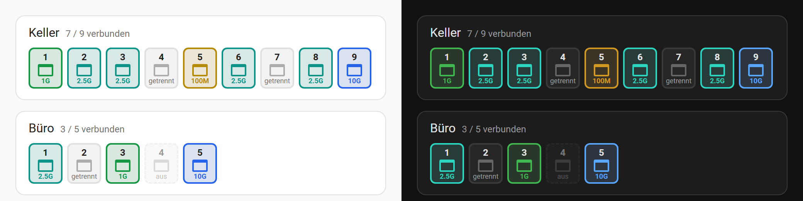

# Generic Realtek Switch — Home Assistant integration

[](https://github.com/hacs/integration)
[](https://github.com/brunoz78/generic_realtek_switch_ha/releases)
[](https://github.com/brunoz78/generic_realtek_switch_ha/actions/workflows/validate.yml)
[](LICENSE)
[](https://www.home-assistant.io/)

🇬🇧 English · 🇩🇪 [Deutsch](README.de.md)

Monitor managed switches with a Realtek chip directly in Home Assistant — **no extra app, no Docker, no service in between**. It covers switches with the common Realtek web interface used by many low-cost brands (e.g. HORACO, keepLink, Lianguo, Mokerlink) and every switch running the replacement firmware [RTLPlayground](#rtlplayground). Whether a switch works depends on its web interface, not on the brand — see [Supported devices](#supported-devices).

The integration logs in to the web interface of the switch and reads device info, port status and counters straight from its pages. It handles two page layouts of the firmware: one with the port data on the info page and one with it on the port page (e.g. keepLink KP-9000-9XHML-X and HORACO ZX-SWTGW215AS). Each switch becomes one device; several switches can be added side by side. Entity names follow the language of Home Assistant (English or German).

If the switch runs the open-source firmware [RTLPlayground](https://github.com/logicog/RTLPlayground), the integration detects it automatically and reads its JSON interface instead — see [RTLPlayground](#rtlplayground).

---

## Supported devices

### With the original firmware

| Model | Ports | SFP+ | Status |
|-------|-------|------|--------|
| keepLink KP-9000-9XHML-X (HW V3.1, FW V100.9.9.1.7) | 8 × 2.5GbE | 1 × 10G | ✅ Tested |
| HORACO ZX-SWTGW218AS (HW V1.1, FW V1.9.1) | 8 × 2.5GbE | 1 × 10G | ✅ Tested |
| HORACO ZX-SWTGW215AS (HW V1.1, FW V1.9) | 5 × 2.5GbE | 1 × 10G | ✅ Tested |
| keepLink KP9000-9XH-X | 8 × GbE | 1 × 10G | ☑️ Confirmed by the original project |
| HORACO HC-SWTGW218AS | 8 × GbE | 2 × 10G | ☑️ Confirmed by the original project |
| HORACO HC-SWTGW215AS | 5 × GbE | — | ☑️ Confirmed by the original project |

Other switches with a Realtek RTL8372/RTL8373 and the same web interface (login with user name and password on port 80, pages `info.cgi` and `port.cgi`) very likely work as well.

### With the replacement firmware [RTLPlayground](#rtlplayground)

| Model | Ports | SFP+ | Status |
|-------|-------|------|--------|
| keepLink KP-9000-9XHML-X (HW V3.1) | 8 × 2.5GbE | 1 × 10G | ✅ Tested |
| keepLink KP-9000-9XHML-X (HW V3.2) | 8 × 2.5GbE | 1 × 10G | ✅ Tested |
| HORACO ZX-SWTGW218AS (HW V1.1) | 8 × 2.5GbE | 1 × 10G | ✅ Tested |
| HORACO ZX-SWTGW215AS (HW V1.1) | 5 × 2.5GbE | 1 × 10G | ✅ Tested |

Tested with RTLPlayground `v0.1.0-1856aeb`. The web interface is the same on every device, so any switch from the [RTLPlayground device list](https://github.com/logicog/RTLPlayground/blob/main/doc/supported_devices.md) should work.

**Legend:** ✅ tested by me · ☑️ confirmed by others or very similar

**Found a compatible device?** Open an [issue](https://github.com/brunoz78/generic_realtek_switch_ha/issues/new) so it can be added to the table.

---

## Features

- 🔌 **Port monitoring** — one sensor per port with link and speed (e.g. `Disconnected`, `1000M`, `2500M`), optionally duplex, flow control, packet and error counters
- 🟩 **Port strip for dashboards** — a card of its own shows all ports of a switch like the RTLPlayground web interface, coloured by speed
- 🔄 **Reboot button** — restart the switch from any dashboard or automation
- ⬆️ **Firmware update** — with RTLPlayground, install new firmware straight from Home Assistant; the right image is picked automatically
- ⚡ **Direct polling on the LAN** — fully local, no cloud, no proxy
- 🔧 **Adjustable polling interval** — 10 to 300 seconds (default 30 s)

---

## Installation

### Through HACS (recommended)

1. HACS → Integrations → ⋮ → **Custom repositories**
2. URL: `https://github.com/brunoz78/generic_realtek_switch_ha` · Type: **Integration**
3. Install **Generic Realtek Switch** and restart Home Assistant
4. **Settings → Devices & services → Add integration → Generic Realtek Switch**

### Manually

1. Download `generic_realtek_switch.zip` from the latest [release](https://github.com/brunoz78/generic_realtek_switch_ha/releases/latest)
2. Unpack it and copy the folder `generic_realtek_switch/` to `<config>/custom_components/`
3. Restart Home Assistant and add the integration in the UI

---

## Setup

| Field | Default | Note |
|-------|---------|------|
| Switch IP address | — | e.g. `192.168.1.100` |
| HTTP port | `80` | Only change it if the web interface runs on another port |
| User name | `admin` | Factory setting of most models; with [RTLPlayground](#rtlplayground) just leave `admin` |
| Password | `admin` | Factory setting of most models; RTLPlayground ships with `1234` |

Add the integration once per switch. Afterwards, **Configure** on the integration card sets the polling interval (10–300 s).

**Change the IP address or password later:** choose **Reconfigure** in the menu (⋮) of the switch entry. Entities, history and dashboards stay as they are. If a switch with RTLPlayground rejects the stored password, Home Assistant asks for the new one by itself (notice under *Settings → Devices & services*).

---

## Entities

Each switch gets **one device** named `Switch <IP address>`, e.g. `Switch 192.168.1.100`. All entities — those of the individual ports too — belong to this device.

### Switch

| Entity | Type | Description |
|--------|------|-------------|
| Firmware | Sensor | Firmware version |
| MAC Address | Sensor | MAC address of the switch |
| Ports Up | Sensor | Number of connected ports |
| Ports Total | Sensor | Number of physical ports |
| Reboot | Button | Restarts the switch |
| Uptime | Sensor | e.g. `3d 14h 22m` — **only** if the firmware reports it (KP-9000-9XHML-X and ZX-SWTGW215AS don't) |
| Temperature | Sensor | Chip temperature in °C — **only** with RTLPlayground |

### Per port *(N = 1 … number of ports)*

| Entity | Type | Default | Description |
|--------|------|---------|-------------|
| Port N | Sensor | enabled | Link and speed in one: `Disconnected` · `Disabled` · `10M` · `100M` · `1000M` · `2500M` · `5000M` · `10G`. Carries all port values as attributes. |
| Port N Duplex | Sensor | disabled | `Full` or `Half` |
| Port N Flow Control | Sensor | disabled | `Enabled` or `Disabled` |
| Port N TX Packets | Sensor | disabled | Packets sent (increasing) |
| Port N RX Packets | Sensor | disabled | Packets received (increasing) |
| Port N TX Errors | Sensor | disabled | Packets sent with errors (increasing) — rising values point to cable or connector problems |
| Port N RX Errors | Sensor | disabled | Packets received with errors (increasing) |
| Port N TX / RX | Sensor | disabled | Bytes (increasing) — **only** if the switch has byte counters (KP-9000-9XHML-X and ZX-SWTGW215AS don't) |
| Port N learned devices | Sensor | disabled | Number of MAC addresses the switch has learned on this port, roughly the number of devices behind it — **only** with RTLPlayground from October 2026 |

**Disconnected** means the port is enabled but nothing is connected (no cable or the other side is off). **Disabled** means the port was switched off on purpose in the web interface of the switch.

Disabled entities can be enabled under **Settings → Devices & services → Entities**.

If reading the statistics page fails once, the packet and error counters briefly show "Unknown" instead of `0`. That way Home Assistant doesn't take a hiccup for a counter reset, which would distort the long-term statistics.

Entity IDs are always English, whatever the language, and follow the pattern `sensor.switch_192_168_1_100_port_3`, `sensor.switch_192_168_1_100_port_3_duplex`, `…_flow_control`, `…_tx_packets`, `…_rx_errors`, `…_learned_macs` and so on. In automations the states of the port sensor are `disconnected`, `disabled`, `10m`, `100m`, `1000m`, `2500m`, `5000m` and `10g`.

---

## Dashboard card "port strip"



The integration comes with a card of its own that shows all ports of a switch as a strip: colour by speed (yellow 10/100M, green 1G, teal 2.5G/5G, blue 10G), disconnected ports grey, disabled ports dashed. A click on a port opens its details; hovering shows the port name, the SFP module and the learned devices. It works with both firmwares; port name, SFP module and learned devices are only reported by RTLPlayground.

The card is loaded automatically, nothing needs to be added under *Resources*. On a dashboard choose **Add card → Generic Realtek Switch** and pick the switch. Or in YAML:

```yaml
type: custom:generic-realtek-switch-card
device: <device id>   # picked in the card editor
title: Basement       # optional, default: the device name
expected:             # optional: ports that should run at least this fast
  2: 2.5G
  8: 2.5G
```

**Expected speed:** for ports listed under `expected` (in the card editor: "Expected speed per port", e.g. `2:2.5G, 8:2.5G`) the card warns as soon as the port runs slower or is disconnected: red frame with a `!` badge, "⚠ 1 below target" in the header and "expected 2.5G, is 1G" in the tooltip. Disabled ports don't warn.

**Actions in the header:** ↻ restarts the switch (after asking), **Update** appears when the firmware entity offers a new version and opens it, ↗ opens the web interface of the switch. Each can be switched off in the card editor (`show_reboot`, `show_update`, `show_web`: `false`).

After an update of the integration the browser loads the new card by itself; if not, reload the page once with Ctrl+F5. The Home Assistant app keeps its own cache: there, use *Settings → Companion app → Troubleshooting → Reset frontend cache* and restart the app.

---

## Example automations

### Notification when a port goes down

```yaml
alias: "Switch port 3 disconnected"
triggers:
  - trigger: state
    entity_id: sensor.switch_192_168_1_100_port_3
    to: "disconnected"
    for: "00:00:30"
actions:
  - action: notify.mobile_app
    data:
      title: "⚠️ Network warning"
      message: "Switch port 3 is no longer connected"
```

### Weekly reboot

```yaml
alias: "Switch reboot Sunday 3 am"
triggers:
  - trigger: time
    at: "03:00:00"
conditions:
  - condition: time
    weekday: [sun]
actions:
  - action: button.press
    target:
      entity_id: button.switch_192_168_1_100_reboot
```

---

## How it works

On every poll (every N seconds):

1. **Login** — `POST /login.cgi` with user name, password and `MD5(user name + password)`; the hash is sent as a cookie with the following requests
2. `GET /info.cgi` → model, firmware, MAC, uptime; depending on the firmware also link and speed per port
3. `GET /port.cgi?page=stats` → packet and error counters per port
4. `GET /port.cgi` → port enabled/disabled; if `/info.cgi` has no port table (e.g. KP-9000-9XHML-X, ZX-SWTGW215AS), link, speed/duplex and flow control come from here

The **Reboot** button sends `POST /reboot.cgi` with `cmd=reboot`.

Every request carries the HTTP `Referer` header. Newer firmware (e.g. V100.9.9.1.7 on hardware V3.1) returns an empty page without it — which is why a URL like `http://<ip>/info.cgi` typed into the address bar stays blank. Older firmware (e.g. V1.9 on hardware V1.1) doesn't check it.

There is a 0.4 s pause between requests so the microcontroller of the switch isn't overloaded. If the switch drops a connection without answering (happens now and then with some firmware versions), the request is repeated up to three times.

---

## RTLPlayground

[RTLPlayground](https://github.com/logicog/RTLPlayground) is an open-source replacement firmware for switches with a Realtek RTL8372/RTL8373. The integration detects it from the login page during setup and on every start of Home Assistant. If a switch that is already set up gets reflashed, the integration switches over by itself as soon as the entry is reloaded (Settings → Devices & services → Generic Realtek Switch → ⋮ → **Reload**) or Home Assistant restarts — provided the IP address and password stayed the same; otherwise use **Reconfigure**. The duplex and flow control entities of the original firmware disappear in the process.

**Setup:** as above. RTLPlayground has no user name: the field can stay at `admin`, it is ignored. The factory password is `1234`.

**What's different:**

| | Original firmware | RTLPlayground |
|---|---|---|
| Port N, TX/RX packets, TX/RX errors | ✅ | ✅ |
| Port N Duplex, Port N Flow Control | ✅ | — (not reported by the firmware) |
| Temperature of the switch chip | — | ✅ |
| Last restart (point in time, from the uptime) | — | ✅ with firmware that reports the uptime (`uptime` in `/information.json`) |
| Port name and SFP module | — | as attributes `port_name` and `sfp_module` of the "Port N" sensor |
| Learned devices per port | — | ✅ from October 2026 (`macs` in `/status.json`) |
| Firmware | e.g. `V1.9.1` | e.g. `RTLPlayground v0.1.0-f0aea3d` |

An SFP slot without a module shows as `Disconnected`, not `Disabled`.

**Sessions:** older firmware knows only one logged-in session. Logging in with a browser takes the session away from Home Assistant. The integration notices that and **pauses polling for 5 minutes** (the entities are "Unavailable" meanwhile) so the web interface stays usable; then it logs in again — which logs the browser out. If the firmware keeps several sessions, the integration notices that at login: browser and Home Assistant don't get in each other's way, and after a restart of the switch it logs in again right away, without a pause.

**Firmware update:** switches with RTLPlayground get the entity **Firmware** (`update.switch_<ip>_firmware`). It compares the installed version with the latest release of a GitHub repository (default `brunoz78/RTLPlayground`, changeable under **Configure**) and shows "Update available" like other devices in Home Assistant, with release notes — but only if the release holds an image for exactly this model. The default repository builds only the models tested above; for other switches the entity stays quiet until you enter a repository with fitting images under **Configure**. **Install** downloads the image for exactly this device — recognised by the device name the firmware reports, which every image contains —, checks size and checksum, uploads it like the web interface does and waits until the switch runs again (about 1–2 minutes). If no image of the release fits the device, nothing is installed. When several switches are updated at once, the integration handles them one after the other, so no upload breaks off because a switch in front of it is restarting. An interrupted upload is harmless anyway: the firmware only takes over an image once it is complete and its checksum is right. The integration asks the repository at most once an hour; whether a new release has a fitting image it checks once per release and model (downloading the images, 512 KiB each).

**Polling:** `POST /login` with the password → session cookie; then `GET /information.json` (model, MAC, firmware, temperature) and `GET /status.json` (link, speed, packet and error counters per port). The reboot button calls `GET /reset`, a firmware update `POST /upload`.

---

## Contributing

Workflow: fork → branch → pull request → all CI checks green (HACS, hassfest, tests) → merge.

The tests run without a switch and without Home Assistant against real pages of the tested models (`tests/fixtures/`):

```bash
pip install -r requirements_test.txt
python -m pytest tests
```

When adding a new model, best put its `info.cgi`, `port.cgi` and `port.cgi?page=stats` (MAC and IP anonymised) into a new folder under `tests/fixtures/`.

**Found a compatible device?** Open an [issue](https://github.com/brunoz78/generic_realtek_switch_ha/issues/new) with model, firmware version and ports, and it will be added to the table.

---

## License

MIT — see [LICENSE](LICENSE)

## Credits

Originally a fork of [gtrancillo/horaco_switch_ha](https://github.com/gtrancillo/horaco_switch_ha).

The knowledge about the CGI endpoints and the polling approach comes from [byte4geek/switch-dashboard](https://github.com/byte4geek/switch-dashboard).
